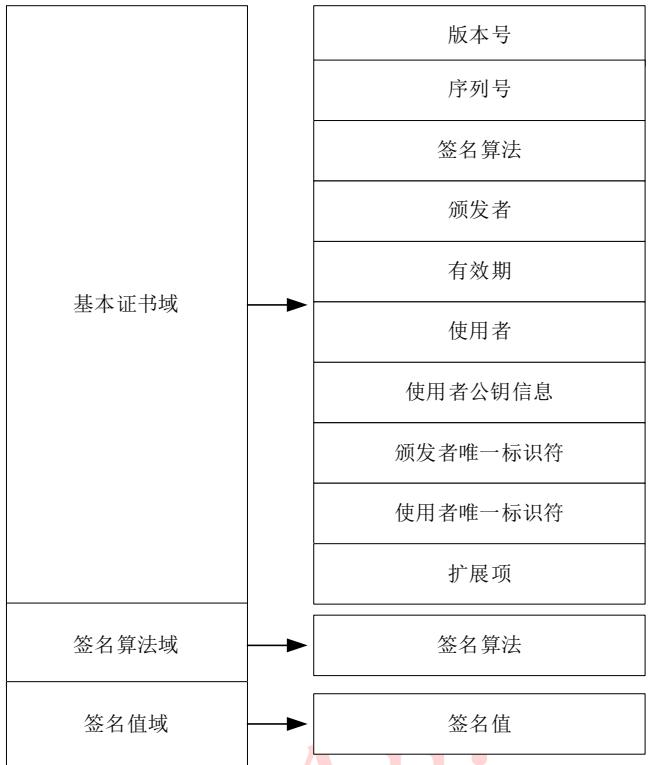
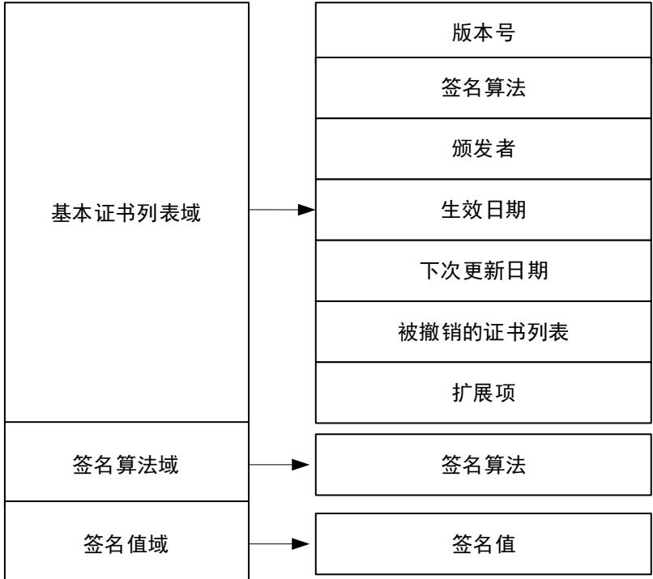

# 信息安全技术 数字证书管理<sub>代替</sub>第5部分：证书格式


## 目 次

前言 . III  
引言 .  
1 范围 ..  
2 规范性引用文件 .  
3 术语和定义  
4 缩略语 .. 2  
5 总体原则和要求 . 3  
5.1 总则 ... 3  
5.2 总体要求 . 3  
6 数字证书格式 .  
6.1 综述 ..  
6.2 数字证书数据结构 ..  
6.3 基本证书域数据字段内容 .  
6.4 签名算法域数据字段内容 .. <sup>.....................</sup><sub>.....................</sub>  
6.5 签名值域数据字段内容  
7 CRL 格式.  
7.1 综述 ..  
7.2 CRL 数据结构..  
7.3 CRL基本列表域数据字段内容. 8  
7.4 CRL签名算法域数据字段内容. 9  
7.5 CRL 签名值域字段内容.. 9  
附录A （资料性） 数字证书私钥的组成. 10  
附录B （资料性） 数字证书编码举例.. 12  
附录C （资料性） 数字证书 ASN.1结构.. 20  
附录D （规范性） 数字证书编码中 OID的点分十进制的转换方法... 22  
附录E （规范性） 设备命名.. 23  
附录F （资料性） 数字证书扩展项.. 25  
参考文献 ... 26

## 前 言

本文件按照GB/T 1.1—2020《标准化工作导则 第1部分：标准化文件的结构和起草规则》的规定起草。

本文件是T/WAPIA 013《信息安全技术 数字证书管理》的第5部分。T/WAPIA 013已经发布了以下部分：

第2部分：证书存储和使用；

第5部分：证书格式。

本文件代替T/WAPIA 013.5—2012 《WAPI证书管理 第5部分：证书格式范例》，与T/WAPIA013.5—2012相比主要技术变化如下：

a) 更改了文件名称；

b) 增加了对SM2和SM3算法的支持（见5.1）；

c) 增加了应用领域（见5.2）；

d) 增加了CRL格式（见第7章）；

e) 更改了附录A（见附录A，2012版的附录C）；

f) 更改了附录B（见附录B，2012年版的附录A）；

g) 更改了附录C（见附录C，2012年版的附录D）；

h) 更改了附录D（见附录C，2012年版的附录B）；

i) 更改了附录E（见附录E）；

j) 更改了附录F（见附录F，2012年版的附录E）。

请注意本文件的某些内容可能涉及专利。本文件的发布机构不承担识别专利的责任。

本文件由中关村无线网络安全产业联盟与工业和信息化部宽带无线IP标准工作组联合提出。

本文件由无线网络安全标准化委员会归口。

本文件起草单位：西安西电捷通无线网络通信股份有限公司、无线网络安全技术国家工程研究中心、中关村无线网络安全产业联盟、工业和信息化部宽带无线IP标准工作组、国家无线电监测中心检测中心、西安芯语慧联信息科技有限公司、深圳市智开科技有限公司、北京数字认证股份有限公司。

本文件主要起草人：张国强、张变玲、简练、侯鹏亮、尹玉昂、童伟刚、刘高锦、黄振海、郑骊、陈晓龙、刘婷、张璐璐、王立华、李琴、颜湘、杜志强、周涛、田玉存、王月辉、米东。

本文件及其所代替文件的历次版本发布情况为：

2012 年首次发布为 T/WAPIA 013.5—2012；

— 本次为第一次修订。

## 引 言

三元对等架构（TePA）是为网络连接双方提供对等安全的架构，通过引入可信第三方，为在连接建立前需要通过对端实体访问可信第三方的一端和对端之间提供对等安全保障，其核心技术已发布为ISO/IEC 9798-3和GB/T 15843.3。

TePA是网络与信息安全领域基础共性技术架构，可应用于有线网络、无线移动网络、近距离通信网络、网络层安全、数据安全与隐私等多个应用领域。

T/WAPIA 013《信息安全技术 数字证书管理》定义了三元对等密码安全协议中所使用的X.509数字证书的格式，为依据GM/T 0042开展三元对等密码安全协议测试提供了支撑，有利于指导符合三元对等密码安全协议的设备生产和方案研发，提高符合三元对等密码安全协议的产品的适用性。T/WAPIA 013拟由五个部分构成。

— 第1部分：总则。目的在于确立数字证书管理总体原则和基本要求等相关内容。

— 第 2 部分：证书存储和使用。目的在于规范数字证书及私钥在独立安全介质中的安全存储、安全分发和安全使用相关内容。

— 第 3 部分：证书颁发。目的在于规范数字证书申请、审核、签发、验证等相关内容。

— 第4部分：证书撤销。目的在于规范数字证书撤销流程等相关内容。

— 第5部分：证书格式。目的在于规范数字证书基本结构及各数据项内容。

本文件中所涉及到的X.509数字证书内容与GB/T 20518—2018的关系如下：

a) 本文件中涉及的X.509数字证书的定义、结构和描述同GB/T 20518—2018一致；

b) 本文件进一步描述了GB/T 20518—2018中所定义的数字证书和证书撤销列表在三元对等密码安全协议应用中应包含的数据项及其定义。

本文件实施过程中，涉及到密码技术的具体应用时，适用密码算法相关国家标准、行业标准，以及国家密码管理主管部门的有关规定。

# 信息安全技术 数字证书管理 第 5部分：证书格式

## 1 范围

本文件根据GB/T 20518—2018所规定的数字证书和证书撤销列表的基本结构，提出了总体原则和要求，规范了数字证书格式和证书撤销列表格式。

本文件适用于采用三元对等密码安全协议的设备生产、网络运营以及检验检测。

## 2 规范性引用文件

下列文件中的内容通过文中的规范性引用而构成本文件必不可少的条款。其中，注日期的引用文件，仅该日期对应的版本适用于本文件；不注日期的引用文件，其最新版本（包括所有的修改单）适用于本文件。

GB/T 15629.3 信息技术 系统间远程通信和信息交换 局域网和城域网 特定要求 第3部分：带碰撞检测的载波侦听多址访问（CSMA/CD）的访问方法和物理层规范

GB 15629.11—2003/XG1—2006 信息技术 系统间远程通信和信息交换 局域网和城域网 特定要求第11部分：无线局域网媒体访问控制(MAC)和物理(PHY)层规范 第1号修改单

GB 15629.11（所有部分） 信息技术 系统间远程通信和信息交换 局域网和城域网 特定要求 第11部分：无线局域网媒体访问控制(MAC)和物理(PHY)层规范

GB/T 15843.3 信息技术 安全技术 实体鉴别 第3部分：采用数字签名技术的机制

GB/T 16262.1 信息技术 抽象句法表记法—(ASN.1) 第1部分：基本记法规范

GB/T 16263.1 信息技术 ASN.1 编码规则 第1部分：基本编码规则（BER）、正则编码规则（CER）和非典型编码规则（DER）规范

GB/T 20518—2018 信息安全技术 公钥基础设施 数字证书格式

GB/T 25068.5 信息技术 安全技术 网络安全 第5部分：使用虚拟专用网的跨网通信安全保护

GB/T 28455 信息安全技术 引入可信第三方的实体鉴别及接入架构规范

GB/T 32905 信息安全技术 SM3密码杂凑算法

GB/T 32918.2 信息安全技术 SM2椭圆曲线公钥密码算法 第2部分：数字签名算法

GM/T 0015—2012 基于SM2密码算法的数字证书格式规范

T/WAPIA010.1 信息技术 系统间远程通信和信息交换 局域网和城域网 特定要求 第 11 部分：无线局域网媒体访问控制和物理层规范 补篇 1：无线局域网网络设备标识规范

T/WAPIA 045（所有部分） 信息技术 系统间远程通信和信息交换 原子密钥建立与实体鉴别

T/WAPIA 046 无线局域网安全技术规范

## 3 术语和定义

下列术语和定义适用于本文件。

## 3.1

公钥证书 public key certificate

用户的公钥连同其他信息，并由发布该证书的 CA的私钥进行加密使其不可伪造。

[来源：GB/T 20518—2018，3.2]

## 3.2

证书序列号 certificate serial number

在CA颁发的证书范围内为每个证书分配的唯一整数值。此整数值与该 CA所颁发的每张证书是唯一的。

## T/WAPIA 013.5—2024

[来源：GB/T 20518—2018，3.4]

## 3.3

证书认证机构 certification authority

受用户信任，负责创建和分配证书的权威机构。证书认证机构也可以为用户创建密钥。

[来源：GB/T 20518—2018，3.5]

## 3.4

数字证书 digital certificate

由国家认可的，具有权威性、可信性和公正性的第三方证书认证机构（CA）进行数字签名的一个可信的数字化文件。

[来源：GB/T 20518—2018，3.7]

## 3.5

证书撤销列表 certificate revocation list

是证书认证机构对已撤销的证书签发的一个已标识的列表，它指定了一套证书颁发者确认为无效的证书。

[来源：GB/T 20518—2018，3.3，有修改]

## 3.6

三元对等密码安全协议 cryptography and security protocol in tri-element peer architecture

基于三元对等架构实现通信实体之间对等鉴别和安全通信的密码安全协议。

[来源：GM/T 0042—2015，3.8，有修改]

## 4 缩略语

下列缩略语适用于本文件。

AAC 鉴别访问控制器（authentication access controller）

AC 接入点控制器（AP controller）

AE 鉴别器实体（authenticator entity）

AP 接入点（access point）

AS 鉴别服务器（authentication server）

ASN.1 抽象语法记法一（abstract syntax notation one）

ASU 鉴别服务单元（authentication service unit）

ASUE 鉴别请求者实体（authentication supplicant entity）

AKEA 原子密钥建立与实体鉴别（atomic key establishment and entity authentication）

CA 证书认证机构（certificate authority）

CIS 证书签发服务器（certificate issue server）

CISU 证书签发服务单元（certificate issue service unit）

CRL 证书撤销列表（certificate revocation list）

DER ASN.1的非典型编码规则（distinguished encoding rules）

EACI 同轴电缆通信基础架构安全（EOC infrastructure security）

ECDSA 椭圆曲线签名（elliptic curve digital signature algorithm）

EFHP 增强型四次握手协议（enhanced four-way handshaking protocol）

EIDSA 电子身份安全（eID security）

EOC 以太数据通过同轴电缆传输（ethernet over cable）

EVSec 终端密钥即抛型端到端语音安全（end-to-end voice security）

IP 互联网协议（internet protocol）

NEAU NFC实体鉴别（NFC entity authentication）

MAC 媒体访问控制（media access control）

MPAS 非接触式移动支付安全防护（RFMP air-interface security）  
MFSec 磁域网安全（magnetic field area network security）  
OID 对象标识符（object identifier）  
PEM 增强的保密邮件（privacy enhanced mail）  
PON 无源光网络（passive optical network）  
REQ 请求者（requester）  
RFMP 基于射频的移动支付（RF-based mobile payment）  
TePA 三元对等架构（tri-element peer architecture）  
TAAA 三元接入鉴别与授权（tri-element access authentication and authorization）  
TAEA 基于三元对等架构的匿名实体鉴别（TePA-based anonymous entity authentication）  
TCA 可信连接架构（trusted connect architecture）  
TCP 传输控制协议（transmission control protocol）  
TISec IP安全可信（trust of IP security）  
TLSec 基于三元对等架构的局域网安全（TePA-based LAN security）  
TMSS 三元对等移动通信系统安全（tri-element mobile system security）  
TPLS 基于三元对等架构的无源光网络安全（TePA-based PON security）  
TRAIS 标签和读写器空中接口安全（tag and reader air-interface security）  
TSSI 基于三元对等架构的传感器网络安全（TePA-based sensor networks security  
infrastructure）  
TTS 传输安全可信（trust of TCP security）  
WAI 无线局域网鉴别基础结构（WLAN authentication infrastructure）  
WAPI 无线局域网鉴别与保密基础结构（WLAN authentication and privacy infrastructure）  
WLAN 无线局域网（Wireless local area network）  
WPAN 无线个域网（wireless personal area network）  
WSAI 无线个域网安全接入基础结构（WPAN security access infrastructure）

## 5 总体原则和要求

## 5.1 总则

三元对等密码安全协议中运用了公钥技术，使用鉴别公钥是一个基本要求，公钥通常封装在数字证书中。数字证书保护公钥和它的身份验证数据，由CA加以数字签名。

CRL是CA对撤销的证书而签发的一个列表文件，该文件可用于三元对等密码安全协议鉴别服务单元鉴别用户证书的有效性。

三元对等密码安全协议中采用的数字证书为X.509 V3格式，CRL为X.509 V2的格式。数字证书私钥组成见附录A。

## 5.2 总体要求

三元对等密码安全协议中使用的数字证书和CRL应基于以下两种密码算法中的一种：

a) 基于SM2密码算法，采用的签名算法为符合GB/T 32918.2规定的SM2数字签名，杂凑算法为符合GB/T 32905规定的SM3。公钥算法标识、签名算法标识以及密钥交换均采用OID方式表示。公钥算法字段采用OID 标识SM2椭圆曲线公钥密码算法；签名算法字段采用OID 标识基于SM2的数字签名算法；椭圆曲线参数字段采用OID 标识基于SM2的曲线参数。相关OID值应符合GM/T0015—2012的规定；

b) 基于ECDSA密码算法，采用的签名算法为ECDSA-192，杂凑算法为SHA-256。公钥算法标识、签名 算 法 标 识 以 及 椭 圆 曲 线 参 数 均 采 用 OID 方 式 表 示 ， OID 取 值 应 符 合 GB15629.11—2003/XG1—2006中8.1.3.1的规定。公钥算法字段采用OID值1.2.840.10045.2.1 标识椭圆曲线算法，并在密钥用途字段中标明为签名用途；签名算法字段采用OID 值

1.2.156.11235.1.1.1标识基于 SHA-256 的ECDSA-192算法；椭圆曲线参数字段 采 用OID值

1.2.156.11235.1.1.2.1 标识国家密码管理局批准的专用于无线局域网的曲线参数。

在三元对等密码安全协议中使用数字证书和CRL，应符合GB/T 20518—2018及本文件的规定和具体安全协议相关技术标准要求。符合GB15629.11（所有部分）的无线局域网WAPI安全协议采用基于ECDSA密码算法的数字证书和CRL，符合GB/T 15629.3的以太网TLSec安全协议、符合GB/T 25068.5的TISec安全协议、符合T/WAPIA 046的WAI增强协议和符合T/WAPIA 045的AKEA协议均采用基于SM2密码算法的数字证书和CRL。

符合三元对等密码安全协议的产品解析、存储及使用的数字证书和CLR的格式应符合本文件规定，数字证书和对应的私钥应被安全存储和使用。

## 6 数字证书格式

## 6.1 综述

本文件应采用符合GB/T 16263.1的DER对数字证书中的各项信息进行编码，组成特定的证书数据结构。DER编码是关于每个字段的类型、长度和取值的编码系统，DER编码结构见图1。

<table><tr><td>类型</td><td>长度</td><td>取值</td></tr></table>

## 图1 DER 编码结构

在对数字证书解析的过程中，应按照先判断类型，再确定长度，根据长度读取数值的方式进行。

数字证书存储和传输等操作可以以下方式处理：

a) 数字证书以base64binary为编码类型、以PEM格式进行存储（文件名的后缀如.cer或者.pl等）；

b) 数字证书以PKCS #12格式存储的证书和相应私钥（文件名的后缀如.p12或者.pfx等）。

## 6.2 数字证书数据结构

数字证书数据结构由三个域组成：

a) 基本证书域

包含版本号、序列号、签名算法、颁发者和使用者名称、使用者公钥信息、有效期等。

b) 签名算法域

包含证书签发机构签发该证书所使用的密码算法标识符和可选参数。

c) 签名值域

包含证书签发机构对该证书的基本证书域的数据加以数字签名的签名值。

三元对等密码安全协议中使用的数字证书格式见图2。

  
图2 三元对等密码安全协议中使用的数字证书格式

符合三元对等密码安全协议的数字证书编码举例参见附录B，数字证书的基本数据结构用ASN.1描述见附录C；数字证书中公钥算法标识、签名算法标识以及椭圆曲线参数均采用OID方式表示，OID的点分十进制的转换方法见附录D。

## 6.3 基本证书域数据字段内容

## 6.3.1 版本号

本字段数据结构见GB/T 20518—2018中5.2.3.1。

版本号标明了三元对等密码安全协议中所使用的数字证书的版本号。

## 6.3.2 序列号

本字段数据结构见GB/T 20518—2018中5.2.3.2。

序列号是三元对等密码安全协议中规定的鉴别服务实体、鉴别控制器实体和接入请求者实体所使用的数字证书的唯一标识，为正整数。通过颁发者标识和序列号可以唯一地确定一张证书。

## 6.3.3 签名算法

本字段数据结构见GB/T 20518—2018中5.2.3.3。

本字段包含签发该数字证书所使用的密码算法的标识符。该值同签名算法域中包含的值相同。采用OID标识签名算法，OID值见5.2。

## 6.3.4 颁发者

本字段数据结构见GB/T 20518—2018中5.2.3.4。

三元对等密码安全协议中，颁发者标识了对数字证书签名和颁发的证书签发服务器实体。颁发者命名应符合T/WAPIA 010.1的规定，包含以下五个域：

强制域：取值应符合附录E的规定 ；

国家域：表示管理域所属的国家；

管理域：表示该网络所属的运营者，可以是运营商、政府、企事业等；

网络域：表示在某个运营者域的网络设备层次；

设备域：表示设备的名称，要求不超过127个数字或字母的组合。

## 6.3.5 有效期

本字段数据结构见GB/T 20518—2018中5.2.3.5。

本字段标明了该数字证书的有效期，包含有起始时间和终止时间。

## 6.3.6 使用者

本字段数据结构见GB/T 20518—2018中5.2.3.6。

在某些标准中也被称为“主体”，三元对等密码安全协议中，使用者标识了对数字证书中公钥对应的实体，可以为AAC实体、REQ实体、AS实体和CIS实体。使用者命名应按照T/WAPIA 010.1的规定，包含五个域，具体要求如下：

强制域：取值应符合附录E的规定；

国家域：表示管理域所属的国家，中国 C=CN；

管理域：表示该网络所属的运营者,O= XXXX.subManagementDomain，XXXX 根据以下规则分配：

0000：保留

0001：中国电信

0002：中国移动

0003：中国联通

0004：中国广电

0005-0099：保留

0100-0999：私有

1000-9999：各省根据中国行政区划表取得一个代码，其余保留。

网络域：表示在某个运营者域的网络设备层次，由电信运营商定义，OU=XXX；

设备域：表示网络设备的名称，CN=XXX@Type，Type 表示设备的类型，分为以下六种：

a) ASU：表示AS等相关类型后台鉴别、授权管理设备；

b) AE：表示AP、AC 等WAPI接入设备；

c) ASUE：表示WAPI用户设备；

d) AAC:表示符合GB/T 15843.3、GB/T 28455的接入设备；

e) REQ:表示符合GB/T 15843.3、GB/T 28455的用户设备；

f) CISU：表示CIS等相关类型的证书签发管理设备。

设备域要求不超过127个数字或字母的组合,即XXX@Type的内容长度。

示例1：中国电信一个WAPI AS：CN=SN1@ASU,OU=CS.HN,O=0001,C=CN,DC=WAPI。

示例2：中国电信一个WAPI用户终端：CN=userid@ASUE,OU=CS.HN,O=0001,C=CN,DC=WAPI。

## 6.3.7 使用者公钥信息

本字段数据结构见GB/T 20518—2018中5.2.3.7。

本字段用来标识公钥和对应的公钥算法。公钥算法字段利用OID 标识椭圆曲线算法；椭圆曲线参数字段利用OID标识算法的曲线参数；OID值见5.2

## 6.3.8 颁发者唯一标识符

本字段数据结构见GB/T 20518—2018中5.2.3.8。

三元对等密码安全协议中，此字段为可选项。本字段用来处理使用者或者颁发者名称的重用问题，本文件不建议使用，但在应用过程中应能解析这个项并进行对比。

## 6.3.9 使用者唯一标识符

本字段数据结构见GB/T 20518—2018中5.2.3.9。

三元对等密码安全协议中，此字段为可选项。本字段用来处理使用者名称的重用问题，本文件不建议使用，但在应用过程中应能解析这个项并进行对比。

## 6.3.10 扩展项

## 6.3.10.1 综述

数字证书的扩展项提供了把一些附加属性同用户或公钥相关联的方法以及证书结构的管理方法，格式见附录F。符合三元对等密码安全协议的数字证书可选具备扩展项。

## 6.3.10.2 实体唯一标识

代表一个证书持有者身份的唯一标识，用于关联具体业务，实体唯一标识的OID由各运营商或CA自行申请和定义。

示例：设备MAC地址标识，标识证书使用者关联的网络设备的MAC地址信息。应有唯一的属性值，利用OID值1.2.156.11235.3001.1.13.5.1标识，类型为PrintableString。

## 6.3.10.3 颁发者密钥标识符

本项数据结构见GB/T 20518—2018中5.2.4.2.2。

颁发者密钥标识符用以识别与证书签名私钥相应的公钥。当颁发者由于有多个密钥共存或由于发生变化而具有多个签名密钥时使用该扩展。可识别基于颁发者证书中的主体密钥标识符或基于颁发者的名称和序列号。

## 6.3.10.4 使用者密钥标识

本项数据结构见GB/T 20518—2018中5.2.4.2.3。

使用者密钥标识符提供一种识别证书的方法，该证书包含一个特定的公钥。此扩展标识了被认证的公开密钥，它能够区分同一主体使用的不同密钥。

## 6.3.10.5 密钥用法

本项数据结构见GB/T 20518—2018中5.2.4.2.4。

说明已认证的公开密钥用于何种用途。用户证书（如：WAPI证书分WLAN终端证书、WLAN设备证书、AS证书等）则根据证书用途，分为“签名”证书和“加密”证书，选择对应的密钥用途进行签发。

## 6.4 签名算法域数据字段内容

本字段包含签发该数字证书所使用的密码算法的标识符。该值同基本证书域中签名算法字段包含的值相同。利用OID标识签名算法，OID值见5.2。

## 6.5 签名值域数据字段内容

本字段包含了对基本证书域进行数字签名的结果，应使用签名算法域标识的签名算法对基本证书域进行签名，签名的结果应按照符合GB/T 16262.1的ASN.1编码成BIT STRING类型保存在数字证书签名值域内。

## 7 CRL 格式

## 7.1 综述

本文件应采用DER对CRL中的各项信息进行编码，组成特定的CRL数据结构。

在对CRL解析的过程中，应按照先判断类型，再确定长度，根据长度读取数值的方式进行。

## 7.2 CRL 数据结构

CRL数据结构由三个域组成：

a) 基本证书列表域

包含了版本号、签名算法、颁发者、生效日期、下次更新日期、被撤销的证书列表和扩展项等相关信息。

## b) 签名算法域

包含证书签发机构签发该CRL所使用的密码算法标识符和可选参数。该域的算法标识符必须与基本证书列表域中的“签名算法”字段的内容相同。

## c) 签名值域

包含证书签发机构对该 CRL的基本证书列表域加以数字签名的签名值。

三元对等密码安全协议中所使用的CRL格式见图3。

  
图3 三元对等密码安全协议中所使用的 CRL 格式

CRL中签名算法标识采用OID方式表示，OID的点分十进制的转换方法见附录D。

## 7.3 CRL基本列表域数据字段内容

## 7.3.1 版本号

本字段数据结构见GB/T 20518—2018中5.3.3.1。如果使用了扩展项，则此项应存在，且其值应是版本号2（用整数1表示）。

本字段标明了三元对等密码安全协议中所使用CRL的版本号。

## 7.3.2 签名算法

本字段数据结构见GB/T 20518—2018中5.3.3.2。

本字段包含签发该CRL所使用的密码算法的标识符。该值同签名算法域中包含的值相同。采用OID标识签名算法，OID值见5.2。

## 7.3.3 颁发者

本字段数据结构见GB/T 20518—2018中5.3.3.3。

三元对等密码安全协议中，颁发者标识了对CRL签名和颁发的证书签发服务器实体。颁发者命名应符合T/WAPIA 010.1的规定，包含以下五个域：

a) 强制域：取值应符合附录E的规定 ；

b) 国家域：表示管理域所属的国家；

c) 管理域：表示该网络所属的运营者，可以是运营商、政府、企事业等；

d) 网络域：表示在某个运营者域的网络设备层次；

e) 设备域：表示设备的名称，要求不超过127个数字或字母的组合。

## 7.3.4 生效日期

本字段数据结构见GB/T 20518—2018中5.3.3.4。

本字段标明了该CRL的颁发日期。

## 7.3.5 下次更新日期

本字段数据结构见GB/T 20518—2018中5.3.3.5。

三元对等密码安全协议中所使用CRL的下一次将要发布的时间。下一次CRL可以在此时间前签发，但不能晚于此时间签发。

## 7.3.6 被撤销的证书列表

本字段数据结构见GB/T 20518—2018中5.3.3.6。

该域标明被撤销的用于三元对等密码安全协议的证书序列号、撤销时间和撤销原因。

如果没有被撤销的证书，此项不存在。否则，列出被撤销证书的序列号，并指定撤销的日期。

## 7.3.7 扩展项

本项是CRL的扩展，只可在版本号2出现。如果出现，此项由一个或多个CRL扩展的序列组成。 CRL扩展项及其数据结构见GB/T 20518—2018中5.3.4。符合三元对等密码安全协议的CRL可选具备此字段的扩展能力。

## 7.4 CRL签名算法域数据字段内容

本字段包含签发该CRL所使用的密码算法的标识符。该值同基本证书域中签名算法字段包含的值相同。采用OID标识签名算法，OID值见5.2。

## 7.5 CRL签名值域字段内容

包含了对基本证书列表域进行数字签名的结果，应使用签名算法域标识的签名算法对基本证书列表域进行签名，签名的结果应按照符合GB/T 16262.1的ASN.1编码成BIT STRING类型保存在CRL签名值域内。

# 附 录 A（资料性）数字证书私钥的组成

## A.1 数字证书私钥的组成

数字证书的私钥由以下部分组成：

a) 私钥的版本；

b) 私钥的内容；

c) 私钥签名的 OID 标识；

d) 私钥对应的公钥值。

## A.2 基于ECDSA密码算法的数字证书私钥的范例

```solidity
30 60 02 01 01 04 18 31 9d c8 36 c2 09 e5 31 c6
31 16 ca 15 d3 88 c0 97 e8 f4 fe 11 21 64 b2 a0
0b 06 09 2a 81 1c d7 63 01 01 02 01 a1 34 03 32
02 04 15 61 78 b6 ef bc 41 5a 7b a8 89 95 28 23
89 7b cf 28 f3 40 7f 3c e1 d0 73 c8 cb c9 17 6c
75 3e 57 34 78 81 b5 1f b9 af ce c0 be a6 fc ee
bb c4
0000 30 60：SEQUENCE{
0002 02 1： INTEGER 1
0005 04 18： OCTET STRING
： 31 9D C8 36 C2 09 E5 31 C6 31 16 CA 15 D3 88 C0
： 97 E8 F4 FE 11 21 64 B2
001F A0 B： [0]{
0021 06 9： OBJECT IDENTIFIER ‘1 2 156 11235 1 1 2 1
： }
002C A1 34： [1]{
002E 03 32： BIT STRING 2 unused bits{
： 04 15 61 78 B6 EF BC 41 5A 7B A8 89 95 28 23 89
： 7B CF 28 F3 40 7F 3C E1 D0 73 C8 CB C9 17 6C 75
： 3E 57 34 78 81 B5 1F B9 AF CE C0 BE A6 FC EE BB
： C4
： }
}
```

## A.3 基于SM2密码算法的数字证书私钥的范例

30 77 02 01 01 04 20 F7 96 07 C2 C8 94 6E B0 FA   
C0 02 63 40 6E D7 67 48 2E 1C 1F 4F C4 C5 8F AC   
0E B7 80 8C 4F A7 13 A0 0A 06 08 2A 81 1C CF 55

```solidity
01 82 2D A1 44 03 42 00 04 11 10 E1 E5 A4 A1 BA
E0 E2 31 63 69 9C 6A 56 91 CD D6 A4 CD E0 FE 4C
21 2D AA 04 19 39 3D DE 13 14 6C 51 1F 0F 55 62
9B 7E F4 12 8B 7E DA CE 6A 38 7D E0 B4 9C 67 E8
7C DA EA B2 5F C5 7F 23 D0
0000 30 77：SEQUENCE{
0002 02 1： INTEGER 1
0005 04 20： OCTET STRING
： F7 96 07 C2 C8 94 6E B0 FA C0 02 63 40 6E D7 67
： 48 2E 1C 1F 4F C4 C5 8F AC 0E B7 80 8C 4F A7 13
0027 A0 A： [0]{
0029 06 8： OBJECT IDENTIFIER ‘1 2 156 10197 1 301
： }
0033 A1 44： [1]{
0035 03 42： BIT STRING 0 unused bits{
： 04 11 10 E1 E5 A4 A1 BA E0 E2 31 63 69 9C 6A 56
91 CD D6 A4 CD E0 FE 4C 21 2D AA 04 19 39 3D DE
13 14 6C 51 1F 0F 55 62 9B 7E F4 12 8B 7E DA CE
6A 38 7D E0 B4 9C 67 E8 7C DA EA B2 5F C5 7F 23
： D0
： }
： }
```

附 录 B

## （资料性）数字证书编码举例

## B.1 基于ECDSA密码算法的数字证书编码

以下内容为一个符合WAPI协议的基于ECDSA密码算法的数字证书编码：

<table><tr><td>30 82 02 45 30 82 01 FA A0 03 02 01 02 02 04 10 00 00 03 30 0C 06 08 2A 81 1C 01 01 05 00 30 51 31 14 93 F2 2C 64 01 19 06 03 55 04 06 13 02 43 4E 31 0D 30 0B 06 06 03</td></tr><tr><td>D7 63 01......0...*...c. 30 12 06 OA 09 92 26 89....0Q1.0.....&amp;. 16 04 57 41 50 49 31 OB 30 09 ..,d....WAPI1.0. 03 55 ..U....CN1.0...U</td></tr><tr><td>04 0A 13 04 30 30 30 33 31 0B 30 09</td></tr><tr><td>0B 13 02 53 4E 31 10 30 OE 06 03 55 04 03 14 07 ...SN1.0...U....</td></tr><tr><td>61 73 31 40 41 53 55 30 1E 17 OD 30 31 30 31 30 as1@ASU0...01010 31 30 31 30 31 30 31 5A 17 OD 31 30 30 34 32 31 1010101Z..100421</td></tr><tr><td>30 32 30 32 30 32 5A 30 52 31 14 30 12 06 OA 09 020202Z0R1.0.... 92 26 89 93 F2 2C 64 01 19 16 04 57 41 50 49 e d. WAPI1</td></tr><tr><td>， 30OB.0...U...CN1.0.日 0B 30 09 06 03 55 04 06 13 02 43 4E 31 OD</td></tr><tr><td>06 03 55 04 0A 13 04 30 30 30 33 31 OB 30 09 06 ..U...00031.0..</td></tr><tr><td>03 55 04 0B 13 02 53 4E 31 11 30 OF 06 03 55 04.U....SN1.0...U.</td></tr><tr><td>03 14 08 61 73 31 2D 32 4041 45 5 30 4A 30 )14 06 ...as1-2@AE0J0..</td></tr><tr><td>07 2A 86 48 CE 3D 02 01 06 09 2A 81 1C D7 63 01 .*.H.=....*...c.</td></tr><tr><td>01 02 01 03 32 00 0415 61 78 B6 EF BC 41 5A 7B ....2...ax...AZ{</td></tr><tr><td>A8 89 95 28 3 23 89 7B CF 28 F3 40 7F 3C E1 D0 73 ... (#. {. (.@ &lt;.. s</td></tr><tr><td>C8 CB C9 17 6C 75 5 3E 57 34 78 81 B5 1F B9 AF CE ....1u&gt;W4x......</td></tr><tr><td>CO BE  A6 FC EE BB 3 C4 A3 81 CB 30 81 C8 30 1D 06.0..0.. 03 55 1D 0E 04 16 04 14 90 B6 6 C4 28 9B .U........... (.</td></tr><tr><td>F1 DC F6 3D 2B 5C AB 6B B6 F3 F6 ED BD 33 FD 30 7C 06 03 =+\. k.....3.0|..</td></tr><tr><td>55 1D 23 04 75 30 73 80 14 0E A5 88 20 FB 4D ) C5 U.#.uOs..... .M.</td></tr><tr><td>33 56 8F EE ECA FC C C1 A4 8D 27 E0 0A 34 A1 55 A4 3V.......’..4.U.</td></tr><tr><td>53 30 51 31 14 30 12 06 0A 09 92 26 89 9 93 F2 2C S0Q1.0.....&amp;...,</td></tr><tr><td>64 01 19 16 04 57 41 50 49 31 0B 30 09 06 03 55 d....WAPI1.0...U</td></tr><tr><td>04 06 13 02 2 43 4E E 31 0D 30 0B 06 03 55 04 0A 13 ....CN1.0...U...</td></tr><tr><td></td></tr><tr><td>04 30 30 30 33 31 0B 30 0906 03 55 04 0B 13 02 .00031.0...U....</td></tr><tr><td>53 4E 31 10 30 0E 06 03 55 04 03 14 07 61 73 31 SN1.0...U....as1</td></tr><tr><td>40 41 53 55 82 04 7F FF 00 08 30 1C 06 03 55 1D @ASU.. ...0...U.</td></tr><tr><td>1F 04 15 30 13 30 11 A0 ) 0F A0 0D 86 0B 68 74 74 ...0.0.......htt</td></tr><tr><td>70 3A 2F 2F 31 2E 63 30 03</td></tr><tr><td>6E OB 06 55 1D 0F 04 p://1.cn0...U...</td></tr><tr><td>04 03 02 07 80 30 0C 06 08 2A 81 1C D7 63 01 01 .....0...*...c..</td></tr><tr><td>01 05 00 03 37 00 0 30 34 02 18 2A FC EA 9B DB 3E ....7.04..*....&gt;</td></tr><tr><td>08 31 F4 .0!., #.).[. j).1.</td></tr><tr><td>C4 4F 21 C7 72C 23 BE 29 9B 5B 1D 6A 29 44 C7 02 18 35E A3 40 E5 4F 7C 86 81 D2 65 DB 53 D... ^.@.0|... e.S</td></tr></table>

## 各字段具体内容和类型定义如下：

0000 30 245：SEQUENCE{  
0004 30 1FA： SEQUENCE{  
0008 A0 3： [0]{  
000A 02 1： INTEGER 2  
： }  
000D 02 4： INTEGER  
： 10 00 00 03  
0013 30 C： SEQUENCE{  
0015 06 8： OBJECT INDENTIFIER ‘1 2 156 11235 1 1 1  
001F 05 0：  
： }  
0021 30 51： SEQUENCE{  
0023 31 14： SET{  
0025 30 12： SEQUENCE{  
0027 06 A： OBJECT INDENTIFIER domainComponent‘0 9 2342 19200300 100 1 25  
0033 16 IA5 STRING ‘WAPI  
： } }  
0039 31 B： SET{  
003B 30 9： SEQUENCE{  
003D 06 3： OBJECT INDENTIFIER countryName‘2 5 4 6  
0042 13 2： PRINTABLE STRING ‘CN  
： }  
： }  
0046 31 D： SET{  
0048 30 B： SEQUENCE{  
004A 06 3： OBJECT INDENTIFIER organizationName‘2 5 4 10  
004F 13 4： PRINTABLE STRING ‘0003  
： }  
： }  
0055 31 B： SET{  
0057 30 9： SEQUENCE{  
0059 06 3： OBJECT INDENTIFIER organizationUnitName ‘2 5 4 11  
005E 13 2： PRINTABLE STRING ‘SN  
： }  
： }  
0062 31 10： SET{  
0064 30 E： SEQUENCE{  
0066 06 3： OBJECT INDENTIFIER commonName‘2 5 4 3  
006B 14 7： T61 STRING ‘as1@ASU  
： }

： }  
： }  
0074 30 1E： SEQUENCE{  
0076 17 D： UTCTime ‘010101010101Z  
0085 17 D: UTCTime ‘100421020202Z  
： }  
0094 30 52： SEQUENCE{  
0096 31 14： SET{  
0098 30 12： SEQUENCE{  
009A 06 A： OBJECT INDENTIFIER domainComponent‘0 9 2342 19200300 100 1 25  
00A6 16 4： IA5 STRING ‘WAPI  
： }  
： }  
00AC 31 B： SET{  
00AE 30 9： SEQUENCE{  
00B0 06 3： OBJECT INDENTIFIER countryName‘2 5 4 6  
00B5 13 2： PRINTABLE STRING ‘CN

00B9 31 D： SET{  
00BB 30 B： SEQUENCE{  
00BD 06 3： OBJECT INDENTIFIER organizationName‘2 5 4 10’  
00C2 13 4： PRINTABLE STRING ‘0003  
： }  
： }  
00C8 31 B： SET{  
00CA 30 9： SEQUENCE{  
00CC 06 3： OBJECT INDENTIFIER organizationUnitName ‘2 5 4 11  
00D1 13 2： PRINTABLE STRING ‘SN  
： }  
： }  
00D5 31 11： SET{  
00D7 30 F： SEQUENCE{  
00D9 06 3： OBJECT INDENTIFIER organizationUnitName ‘2 5 4 11  
00DE 14 8： T61 STRING ‘as1-2@AE  
： }  
： }  
： }  
00E8 30 4A： SEQUENCE{  
00EA 30 14： SEQUENCE{  
00EC 06 7： OBJECT INDENTIFIER ecPublicKey ‘1 2 840 10045 2 1  
00F5 06 9： OBJECT INDENTIFIER ‘1 2 156 11235 1 1 2 1  
： }  
0100 03 22： BIT STRING 0 unused bits{  
： 04 15 61 78 B6 EF BC 41 5A 7B A8 89 95 28 23 89

```solidity
7B CF 28 F3 40 7F 3C E1 D0 73 C8 CB C9 17 6C 75
3E 57 34 78 81 B5 1F B9 AF CE C0 BE A6 FC EE BB
C4
}
}
0134 A3 CB： [3]{
0137 30 C8： SEQUENCE{
013A 30 1D： SEQUENCE{
013C 06 3： OBJECT INDENTIFIER ecPublicKey ‘2 5 19 14
0141 04 16： OCTET STRING
： 04 14 F1 DC F6 90 B6 C4 28 9B 3D 2B 5C AB 6B B6
： F3 F6 ED BD 33 FD
： }
0159 30 7C： SEQUENCE{
015B 06 3： OBJECT INDENTIFIER ecPublicKey ‘2 5 29 35
0160 04 75： OCTET STRING
30 73 80 14 0E A5 88 20 FB 4D C5 33 56 8F EE CA
FC C1 A4 8D 27 E0 0A 34 A1 55 A4 53 30 51 31 14
30 12 06 0A 09 92 26 89 93 F2 2C 64 01 19 16 04
57 41 50 49 31 0B 30 09 06 03 55 04 06 13 02 43
4E 31 0D 30 0B 06 03 55 04 0A 13 04 30 30 30 33
31 0B 30 09 06 03 55 04 0B 13 02 53 4E 31 10 30
0E 06 03 55 04 03 14 07 61 73 31 40 41 53 55 82
04 7F FF 00 08
： }
01D7 30 1C： SEQUENCE{
01D9 06 3： OBJECT INDENTIFIER ecPublicKey ‘2 5 29 31
01DE 04 15： OCTET STRING
： 04 15 30 13 30 11 A0 0F A0 0D 86 0B 68 74 74 70
： 3A 2F 2F 31 2E 63 6E
： }
01F5 30 B： SEQUENCE{
01F7 06 3： OBJECT INDENTIFIER ecPublicKey ‘2 5 29 31
01FC 04 4： OCTET STRING
03 02 07 80
}
}
： }
： }
0202 30 C： SEQUENCE{
0204 06 8： OBJECT INDENTIFIER ‘1 2 156 11235 1 1 1
020E 05 0：
： }
```

0210 03 37： BIT STRING 0 unused bits{： 30 34 02 18 2A FC EA 9B DB 3E C4 4F 21 C7 2C 23： BE 29 9B 5B 1D 6A 29 08 31 F4 44 C7 02 18 5E A340 E5 4F 7C 86 81 D2 65 DB 53 30 E4 AD D2 EA 05： 73 85 84 FC C3 A2： }}

注：对于00标识bitstring位，头字节00表示将bit转换为octet应充0的个数。如果长度为8的整数倍，则不需要补充0；如果长度不是8的整数倍，则应充0使长度达到8的整数倍，头字节表示补充的0的个数。

## B.2 基于SM2密码算法的数字证书编码

以下内容为一个符合WAPI协议的基于SM2密码算法的数字证书编码：

<table><tr><td>30 82 01 A4 30 82 01 49 A0</td><td>03 02 01 02 02 04 20 0...0..I...... 55 01 83 75 05 89 93 F2</td></tr><tr><td>00 00 04 30 0C 06 08 2A 81 CF 00 30 5E 31 17 30 15 06 OA 09 92 26</td><td>...0...*...U..u. 2C 0 1.0. ..&amp;.</td></tr><tr><td>64 01 19 16 07 48 55 46 55 31 32 38</td><td></td></tr><tr><td>06 03 55 04 06 13 02 43 4E 31 0D 30 0B 06</td><td>03 55 ..U....CN1.0...U</td></tr><tr><td>04 0A 13 04 30 30 30 33 31 0B 30 09 06 03</td><td>55 ...00031.0..U.</td></tr><tr><td>0B 13 02 53 4E 31 1A 30 18 06 03 55 04 03 14 11</td><td>...SN1.0...U....</td></tr><tr><td>63 69 73 31 32 34 44 45 44 32 37 31 40 43 49 53</td><td>cis124DED271@CIS</td></tr><tr><td>55 30 1E 17 0D 32 32 31 30 30 31 31 32 30 31 30</td><td>UO...22100112010</td></tr><tr><td>31 5A 17 0D 32 33 31 30 30 31 31 32 30 31 30 31</td><td>1Z..231001120101</td></tr><tr><td>5A 30 53 31 17 30 15 06 0A 09 92 26 89 93 F2 2C</td><td>Z0S1.0.....&amp;...,</td></tr><tr><td>64 01 19 16 07 48 55 46 55 31 32 38 31 0B 30 09</td><td>d....HUFU1281.0.</td></tr><tr><td>06 03 55 04 06 13 02 43 4E 31 0D 30 0B 06 03 55</td><td>..U....CN1.0...U</td></tr><tr><td>04 0A 13 04 30 30 30 33 31 0B 30 09 06 03 55 04</td><td>....00031.0...U.</td></tr><tr><td>0B 13 02 53 4E 31 0F 30 0D 06 03 55 04 03 14 06</td><td>...SN1.0...U....</td></tr><tr><td>61 70 31 40 41 45 30 59 30 13 06 07 2A 86 48 CE</td><td>ap1@AEOYO...*.H.</td></tr><tr><td>3D 02 01 06 08 2A 81 1C CF 55 01 82 2D 03 42 00</td><td>=....*...U..−.B.</td></tr><tr><td>04 11 10 E1 E5 A4 A1 BA EO E2 31 63 69 9C 6A 56</td><td>....1ci. jV</td></tr><tr><td>91 CD D6 A4 CD EO FE 4C 21 2D AA 04 19 39 3D DE</td><td>.………..L!-..9=.</td></tr><tr><td>13 14 6C 51 1F 0F 55 62 9B 7E F4 12 8B 7E DA CE</td><td>..1Q..Ub.</td></tr><tr><td>6A 38 7D E0 B4 9C 67 E8 7C DA EA B2 5F C5 7F 23</td><td>j8}...g.|..._.#</td></tr><tr><td>DO 30 0C 06 08 2A 81 1C CF 55 01 83 75 05 00 03</td><td>.0...*...U..u...</td></tr><tr><td>47 00 30 44 02 20 44 59 0C 5B 03 96 8D 48 9A 7B</td><td>G.OD. DY.[...H. {</td></tr><tr><td>32 F4 8B 87 F7 F8 B0 6B 09 DB 4D 94 53 07 E3 B5</td><td>2......k..M.S...</td></tr><tr><td></td><td>.fv.L.. p....3..</td></tr><tr><td>EC 66 76 C3 4C C1 02 20 70 86 BD 9A F6 33 A1 0F</td><td>.......I..%.V..&gt;</td></tr><tr><td>01 CC 1F 99 A7 96 F0 49 1C 0B 25 92 56 C3 02 3E</td><td></td></tr><tr><td>DA DC 42 CF D0 A7 93 79</td><td>..B....y</td></tr></table>

各字段具体内容和类型定义如下：

0000 30 1A4：SEQUENCE{  
0004 30 149： SEQUENCE{  
0008 A0 3： [0]{  
000A 02 1： INTEGER 2  
： }  
000D 02 4： INTEGER  
： 20 00 00 04  
0013 30 C： SEQUENCE{  
0015 06 8： OBJECT INDENTIFIER ‘1 2 156 10197 1 501  
001F 05 0：  
： }  
0021 30 5E： SEQUENCE{  
0023 31 17： SET{  
0025 30 15： SEQUENCE{  
0027 06 A： OBJECT INDENTIFIER domainComponent‘0 9 2342 19200300 100  
0033 16 IA5 STRING ‘HUFU128  
<sup>003C</sup> <sup>31</sup><sub>003E</sub> <sub>30</sub> <sup>B：</sup><sub>9：</sub> <sup>SET{</sup>SEQUENCE{  
0040 06 3： OBJECT INDENTIFIER countryName‘2 5 4 6  
0045 13 2： PRINTABLE STRING ‘CN  
： }  
： }  
0049 31 D： SET{  
004B 30 B： SEQUENCE{  
004D 06 3： OBJECT INDENTIFIER organizationName‘2 5 4 10  
0052 13 4： PRINTABLE STRING ‘0003  
： }  
： }  
0058 31 B： SET{  
005A 30 9： SEQUENCE{  
005C 06 3： OBJECT INDENTIFIER organizationUnitName ‘2 5 4 11  
0061 13 2： PRINTABLE STRING ‘SN  
： }  
： }  
0065 31 1A： SET{  
0067 30 18： SEQUENCE{  
0069 06 3： OBJECT INDENTIFIER commonName‘2 5 4 3  
006E 14 11： T61 STRING ‘cis124DED271@CISU  
： }  
： }  
}

```postscript
T/WAPIA 013.5—2024
0081 30 1E： SEQUENCE{
0083 17 D： UTCTime ‘221001120101Z
0092 17 D: UTCTime ‘231001120101Z
：
00A1 30 53： SEQUENCE{
00A3 31 17： SET{
00A5 30 15： SEQUENCE{
00A7 06 A： OBJECT INDENTIFIER domainComponent‘0 9 2342 19200300 100 1 25
00B3 16 7： IA5 STRING ‘HUFU128
： }
： }
00BC 31 B： SET{
00BE 30 9： SEQUENCE{
00C0 06 3： OBJECT INDENTIFIER countryName‘2 5 4 6
00C5 13 2： PRINTABLE STRING ‘CN
： }
}
00C9 31 SET{
00CB 30 B： SEQUENCE{
00CD 06 3： OBJECT INDENTIFIER organizationName‘2
00D2 13 PRINTABLE STRING ‘0003
： }
00D8 31 B： SET{
00DA 30 9： SEQUENCE{
00DC 06 3： OBJECT INDENTIFIER organizationUnitName ‘2 5 4 11
00E1 13 2： PRINTABLE STRING ‘SN
： }
： }
00E5 31 F： SET{
00E7 30 D： SEQUENCE{
00E9 06 3： OBJECT INDENTIFIER organizationUnitName ‘2 5 4 3
00EE 14 6： T61 STRING ‘ap1@AE
: }
： }
： }
00F6 30 59： SEQUENCE{
00F8 30 13： SEQUENCE{
00FA 06 7： OBJECT INDENTIFIER ecPublicKey ‘1 2 840 10045 2 1
0103 06 8： OBJECT INDENTIFIER ‘1 2 156 10197 1 301
： }
010D 03 42： BIT STRING 0 unused bits{
： 04 11 10 E1 E5 A4 A1 BA E0 E2 31 63 69 9C 6A 56
91 CD D6 A4 CD E0 FE 4C 21 2D AA 04 19 39 3D DE
13 14 6C 51 1F 0F 55 62 9B 7E F4 12 8B 7E DA CE
```

# 附 录 C

# （资料性）

## 数字证书 ASN.1 结构

数字证书的结构是用ASN.1进行描述数据结构，并使用ASN.1语法进行编码。数字证书基本结构如下:

Certificate ::= SEQUENCE {   
tbsCertificate TBSCertificate,   
signatureAlgorithm AlgorithmIdentifier,   
signatureValue BIT STRING }

}   
Version ::= INTEGER { v1(0), v2(1), v3(2) }   
CertificateSerialNumber ::= INTEGER   
Validity ::= SEQUENCE {   
notBefore Time,   
notAfter Time }   
Time ::= CHOICE {   
utcTime UTCTime,   
generalTime GeneralizedTime }   
UniqueIdentifier ::= BIT STRING   
SubjectPublicKeyInfo ::= SEQUENCE {   
algorithm AlgorithmIdentifier,   
subjectPublicKey BIT STRING }   
Extensions ::= SEQUENCE SIZE (1..MAX) OF Extension   
Extension ::= SEQUENCE {   
extnID OBJECT IDENTIFIER,   
critical BOOLEAN DEFAULT FALSE,   
extnValue OCTET STRING }

上述的证书数据结构由 tbsCertificate， signatureAlgorithm 和 signatureValue 三个域构成。这些域的含义如下。

tbsCertificate 域包含了颁发者名称和使用者名称、使用者的公钥、证书的有效期以及其他的相关信息

— signatureAlgorithm 域包含证书颁发机构颁发该证书所使用的密码算法的标识符。一个算法标识符的ASN.1结构如下：

AlgorithmIdentifier ::= SEQUENCE {

$$
\mathrm { a l g o r i t h m ~ \quad ~ \quad 0 B J E C T ~ { \mathrm { I D E N T I F I E R } } } ,
$$

算法标识符用来标识一个密码算法，其中的 OBJECT IDENTIFIER 部分标识了具体的算法。其中可选参数的内容完全依赖于所标识的算法。该域的算法标识符必须与 tbsCertificate 中的signature标识的签名算法项相同。

signatureValue 域包含了对 tbsCertificate 域进行数字签名的结果。采用 ASN.1 DER 编码的tbsCertificate 作为数字签名的输入，而签名的结果则按照 ASN.1 编码成 BIT STRING 类型并保存在证书签名值域内。

## 附 录 D（规范性）数字证书编码中OID的点分十进制的转换方法

## D.1 转换方法

数字证书中公钥算法标识、签名算法标识以及椭圆曲线参数均采用OID方式表示。三元对等密码安全协议的X.509数字证书编码中OID的点分十进制的转换方法如下：

X.509数字证书编码中数据的第一元素表示为data[1]、第二个元素表示为data[2]依次类推，第i或者k元素表示为data[i]或者data[k]；128\_i表示为128的i次幂。

a) 将data[1]分解，分解公式为：X\*40+Y=data[1]，计算得出X和Y的值；

b) 如果data[2]不小于128,则判断data[3]是否小于128，如果data[3]不小于128，则判断data[4]是否小于128，以此类推，得到data[i]的值是小于128为止，然后按照如下公式进行计算：

data[i]+(data[i-1]-128)\*128\_1+(data[i-2]-128)\*128\_2+data[i-3]-128\*128\_3+......+(data[2]-128)\*128\_(i-2)；

c) 后续根据步骤2）的方法进行转换，起点为k（数据为data[k]）,终点为i（数据为data[i]）,计算公式为：

data[i] + (data[i-1] - 128)\*128\_1+(data[i-2]-128)\*128\_2 +（data[i-3]-128）\*128\_3 +......+ (data[k]-128)\*128\_(i-k)；

d) 点分十进制标识各个阶段得出的结果。

## D.2 转换范例

十六进制数据：2a 81 1c d7 63 01 01 02 01

转换步骤：

a) 第一元素0x2a的转换方式由公式X\*40+Y=0x2a 计算得出X=1和Y=2；

b) 第 二 元 素 0x81 不 小 于 128, 第 三 元 素 0x1c 小 于 128, 即 i=3, 则 计 算 公 式 为 ：data[3]+(data[2]-128)\*128\_(3-2)=0x1c+(0x81-128)\*128\_1=28+1\*128=156；

c) 后 续 元 素 转 换 方 法 中 起 始 元 素 k = 4, 截 止 元 素 i = 5, 则 计 算 公 式 为 ：$\mathrm { d a t a } \left[ 5 \right] + \left( \mathrm { d a t a } \left[ 4 \right] - 1 2 8 \right) * 1 2 8 \_ \left( 5 - 4 \right) \ = 0 \mathrm { x } 6 3 + \left( 0 \mathrm { x } 6 3 + \left( 0 \mathrm { x } 6 3 + \left( 2 \mathrm { x } - 1 2 8 \right) * 1 2 8 \_ 1 - 9 9 + 8 7 * 1 2 8 - 1 1 2 3 5 \right) * 1 2 \right)$ ；后续元素的转换方式为：

1) 起始元素 k=6，截止元素 i=6：data[6]=0x01=1；

2) 起始元素 k=7，截止元素 i=7：data[7]=0x01=1；

3) 起始元素 k=8，截止元素 i=8：data[8]=0x02=2；

4) 起始元素 k=9，截止元素 i=9：data[9]=0x01=1；

d) 点分十进制计算结果：1.2.156.11235.1.1.2.1。

## 附 录 E

（规范性）

## 设备命名

数字证书中的设备命名规则应符合T/WAPIA 010.1的规定。其中强制域为IA5String 类型字符串，取值有两种方式：

强制域=WAPI；符合GB 15629.11（所有部分）的WAPI产品，数字证书采用签名算法ECDSA-192和杂凑算法SHA256的应取该值；

强制域=“HUFU”+掩码字符串FLAG；其中掩码字符串FLAG取值为如下二进制数FLAG对应的十进制数作为字符串；二进制数FLAG定义如表A.1所示。

表A.1 证书强制域二进制数FLAG
<table><tr><td rowspan=1 colspan=1>位</td><td rowspan=1 colspan=1>协议</td><td rowspan=1 colspan=1>含义</td></tr><tr><td rowspan=1 colspan=1>0</td><td rowspan=1 colspan=1>HUFU</td><td rowspan=1 colspan=1>通用</td></tr><tr><td rowspan=1 colspan=1>1</td><td rowspan=1 colspan=1>TTS</td><td rowspan=1 colspan=1>TCP安全</td></tr><tr><td rowspan=1 colspan=1>2</td><td rowspan=1 colspan=1>TLSec                      1   1</td><td rowspan=1 colspan=1>以太网安全</td></tr><tr><td rowspan=1 colspan=1>3</td><td rowspan=1 colspan=1>TPSec</td><td rowspan=1 colspan=1>无源光网络安全Ce</td></tr><tr><td rowspan=1 colspan=1>4</td><td rowspan=1 colspan=1>TPLS</td><td rowspan=1 colspan=1>电力线通信安全</td></tr><tr><td rowspan=1 colspan=1>5</td><td rowspan=1 colspan=1>EACI                    立</td><td rowspan=1 colspan=1>EoC安全 联        明</td></tr><tr><td rowspan=1 colspan=1>6</td><td rowspan=1 colspan=1>1WAPI 1.0</td><td rowspan=1 colspan=1>WLAN安全1.0            </td></tr><tr><td rowspan=1 colspan=1>7</td><td rowspan=1 colspan=1>WAPI 2.0</td><td rowspan=1 colspan=1>WLAN安全2.0</td></tr><tr><td rowspan=1 colspan=1>8</td><td rowspan=1 colspan=1>TAAA</td><td rowspan=1 colspan=1>无线城域网安全</td></tr><tr><td rowspan=1 colspan=1>9</td><td rowspan=1 colspan=1>TMSS</td><td rowspan=1 colspan=1>移动通信网络安全</td></tr><tr><td rowspan=1 colspan=1>10</td><td rowspan=1 colspan=1>TRAIS</td><td rowspan=1 colspan=1>射频识别安全</td></tr><tr><td rowspan=1 colspan=1>11</td><td rowspan=1 colspan=1>NEAU</td><td rowspan=1 colspan=1>近场通信安全</td></tr><tr><td rowspan=1 colspan=1>12</td><td rowspan=1 colspan=1>MPAS</td><td rowspan=1 colspan=1>移动支付安全</td></tr><tr><td rowspan=1 colspan=1>13</td><td rowspan=1 colspan=1>TSSI</td><td rowspan=1 colspan=1>传感网安全</td></tr><tr><td rowspan=1 colspan=1>14</td><td rowspan=1 colspan=1>WSAI</td><td rowspan=1 colspan=1>无线个域网安全</td></tr><tr><td rowspan=1 colspan=1>15</td><td rowspan=1 colspan=1>EFHP</td><td rowspan=1 colspan=1>超宽带安全</td></tr><tr><td rowspan=1 colspan=1>16</td><td rowspan=1 colspan=1>MSAI</td><td rowspan=1 colspan=1>磁域网安全</td></tr><tr><td rowspan=1 colspan=1>17</td><td rowspan=1 colspan=1>TISec</td><td rowspan=1 colspan=1>网络层安全</td></tr><tr><td rowspan=1 colspan=1>18</td><td rowspan=1 colspan=1>EVSec</td><td rowspan=1 colspan=1>语音安全</td></tr><tr><td rowspan=1 colspan=1>19</td><td rowspan=1 colspan=1>TAEA</td><td rowspan=1 colspan=1>匿名技术</td></tr><tr><td rowspan=1 colspan=1>20</td><td rowspan=1 colspan=1>TCA</td><td rowspan=1 colspan=1>可信连接</td></tr><tr><td rowspan=1 colspan=1>21</td><td rowspan=1 colspan=1>EIDSA</td><td rowspan=1 colspan=1>电子身份（eID）安全</td></tr><tr><td rowspan=1 colspan=1>22</td><td rowspan=1 colspan=1>AKEA</td><td rowspan=1 colspan=1>原子密钥建立与实体鉴别</td></tr><tr><td rowspan=1 colspan=1>其余</td><td rowspan=1 colspan=1>保留</td><td rowspan=1 colspan=1></td></tr></table>

证书强制域FLAG说明：  
a）位0为特殊标识位，置1时，其他位置0；即强制域为“HUFU1”表示该证书可通用；  
b）其余位置为1表示该证书支持对应的协议，一个证书可以支持多个协议；  
c）根证书的强制域为“HUFU1”；

d）二进制数FLAG的长度可扩展。

注： 针对WAPI协议，为了兼容既有产品，强制域取值方式保留了方式a)中的DC=WAPI取值，同时为了兼顾命名规则的统一性，在方式b)DC=“HUFU”+掩码字符串FLAG中也给出了定义。

附 录 F

（资料性）

## 数字证书扩展项

数字证书扩展项结构如下：

Extension ::= SEQUENCE { extnID OBJECT IDENTIFIER, critical BOOLEAN DEFAULT FALSE, extnValue OCTET STRING }

extnID：表示一个扩展元素的 OID

critical：表示这个扩展元素是否重要

extnValue：表示这个扩展元素的值，字符串类型。

## 参考文献

[1] GM/T 0042—2015 三元对等密码安全协议测试规范

[2] ISO/IEC 9798-3 信息技术 安全技术 实体鉴别 第3部分：采用数字签名技术的机制（IT Securitytechniques - Entity authentication - Part 3: Mechanisms using digital signaturetechniques）

#
